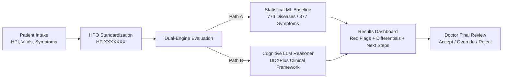
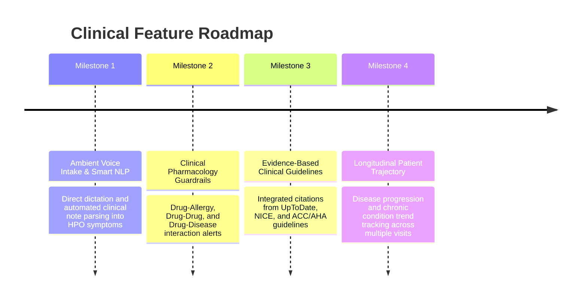

# Clinical Overview & Roadmap ? Doctor Diagnosis Assistant (DDA)

> **Audience:** Attending Physicians, Medical Residents, Clinical Informaticists, and Healthcare Collaborators.  
> **Core Clinical Objective:** Provide a cognitive clinical co-pilot that assists physicians during patient consultations by synthesizing history, vitals, standardized phenotypes, and lab findings into evidence-weighted differential diagnoses and safety red-flag alerts.

---

## 1. Executive Summary: What is DDA?

The **Doctor Diagnosis Assistant (DDA)** is an AI-powered **Clinical Decision Support (CDS)** system designed to work as an intelligent second opinion alongside the treating physician. 

It is built around a strict **"Doctor-in-the-Loop" philosophy**: the AI never makes autonomous diagnoses. Instead, it aggregates clinical evidence, cross-checks findings against machine learning statistical baselines and large language reasoning models, flags acute risks, and presents a structured differential for the physician to **Accept, Edit/Override, or Reject**.

---

## 2. Current Clinical Capabilities (What Works Right Now)

### A. Structured Patient Consultation Intake (`/visits/new`)
- **Full History of Present Illness (OPQRST)**: Captures onset, anatomical location, character (sharp, dull, pleuritic, burning), aggravating/relieving factors, radiation, and progression.
- **Objective Vital Signs Grid**: Temperature, BP (systolic/diastolic with automated validation), Heart Rate, Respiratory Rate, SpO2, Blood Glucose, and Visual Pain Scale (1?10).
- **Antecedents & Baseline Profile**: Comorbidities, active medications, allergy profiles with documented hypersensitivity reactions, and comprehensive social/exposure history (tobacco pack-years, alcohol, diet, travel history).

### B. Standardized Phenotype Mapping (Human Phenotype Ontology ? HPO)
- **Resolves Vocabulary Fragmentation**: Converts free-text entries, colloquial doctor notes, and abbreviations (e.g., *"SOB"*, *"dyspnea"*, *"breathlessness"*) into canonical **Human Phenotype Ontology (HPO)** identifiers (e.g., `HP:0002094` for Dyspnea, `HP:0001945` for Fever, `HP:0001681` for Chest Pain).
- **Categorical Browsing**: Rapid domain-based filtering across Respiratory, Cardiovascular, Gastrointestinal, Neurological, Dermatological, Genitourinary, Musculoskeletal, and Constitutional phenotypes.

### C. Dual-Engine Diagnostic Evaluation (`/visits/:id/results`)
Every consultation runs two independent analytical pathways side-by-side:

1. **Path A ? Statistical ML Classifier (773 Diseases)**:
   - Trained across **773 primary care and chronic conditions** and 377 binary clinical features.
   - Instantly calculates statistical pattern-matching probabilities (e.g., *Community-Acquired Pneumonia: 63.9%, Acute Bronchitis: 18.0%*).
2. **Path B ? Cognitive Clinical Reasoner (DDXPlus Evidence Framework)**:
   - Evaluates disease probability by weighing **Antecedents** (risk factors, age, comorbidities) against **Active Clinical Evidences** (presenting symptoms, physical signs, vital sign abnormalities).
   - Actively evaluates **Pertinent Negatives** (explicitly absent symptoms) to rule out competing diagnoses.
   - Generates a prioritized **Top 2?5 Differential Diagnosis** with explicit clinical justifications citing findings from the patient's case.

### D. Emergency Red-Flag Triage & Next Steps
- **Immediate Warning Detection**: Automatically flags acute life-threatening presentations (e.g., acute coronary syndrome / STEMI, pulmonary embolism, acute surgical abdomen, respiratory failure).
- **Suggested Diagnostic Workup**: Recommends high-yield lab tests, imaging studies (e.g., Chest X-Ray, 12-lead ECG, Troponin I, Abdominal Ultrasound), and specialist referrals.
- **Targeted History Inquiries**: Suggests high-yield clinical questions to ask the patient to definitively differentiate between top considerations.

### E. Diagnostic Labs & Imaging Integration
- Upload and attach digital lab reports (PDF, imaging, DICOM, summaries).
- The AI dynamically ingests new lab values and automatically refreshes its differential reasoning.

### F. Doctor Feedback Loop & Medico-Legal Audit Trail
- **Doctor's Final Decision**: The physician can **Accept** the top suggestion, **Edit/Override** with a custom diagnosis label and rationale, or **Reject** the AI differential.
- **Full Compliance Audit Trail**: Every prediction, reasoning call, and doctor override is immutably logged with timestamp, user ID, and clinical payload for medico-legal accountability and continuous quality improvement.

---

## 3. How the Clinical Case is Structured (DDXPlus Framework)

When evaluating a case, the system formats patient data according to evidence-based medical reasoning:

| Section | Clinical Content | Diagnostic Purpose |
|---|---|---|
| **1. Antecedents** | Age, Sex, Medical History, Active Medications, Allergies, Social Exposures | Establishes the patient's baseline pre-test probability and epidemiological risk factors. |
| **2. Active Evidences** | Chief Complaint, OPQRST HPI, Presenting HPO Symptoms, Vitals, Exam Signs, Labs | Serves as positive likelihood ratios (LR+) that rule in specific etiologies. |
| **3. Pertinent Negatives** | Explicitly absent symptoms (e.g., *No fever, No chest pain, No vomiting*) | Serves as negative likelihood ratios (LR-) to actively rule out competing differentials. |
| **4. Red Flags** | Hemodynamic instability, hypoxia, focal neurological deficits, peritoneal signs | Triggers immediate triage escalation before definitive diagnosis. |

---

## 4. What We Can Build Next: Clinical Roadmap for Doctor Feedback

We would love your input as a physician on prioritizing these next clinical features:

### 1. Ambient Voice & Smart Clinical Note Extractor (NLP)
- **Physician Need:** Reduce documentation burden and typing during consultation.
- **Proposed Capability:** Doctor speaks or pastes a free-text SOAP note -> NLP engine automatically extracts chief complaints, duration, and symptom checkboxes with corresponding HPO codes.

### 2. Clinical Pharmacology & Safety Cross-Checks
- **Physician Need:** Prevent adverse drug events (ADEs) and prescription errors.
- **Proposed Capability:** Real-time safety alerts that cross-check:
  - Proposed treatments against the patient's **documented drug allergies** (e.g., Penicillin -> Cephalosporin cross-reactivity).
  - **Drug-Drug interactions** with active home medications.
  - **Drug-Disease contraindications** (e.g., NSAIDs in active peptic ulcer disease or CKD).

### 3. Integrated Evidence-Based Guidelines & Citations
- **Physician Need:** Quick reference to standard clinical pathways.
- **Proposed Capability:** Provide direct references to gold-standard guidelines (e.g., GOLD guidelines for COPD, Wells score for DVT/PE, CURB-65 for Pneumonia, ACC/AHA for Chest Pain) alongside suggested next steps.

### 4. Objective Lab Reference Range Flagging & Automated Delta Checks
- **Physician Need:** Instant recognition of abnormal biomarkers.
- **Proposed Capability:** Automatic extraction and color-coded visual alerts for critical lab values (e.g., elevated Troponin, leukocytosis, acute creatinine elevation).

### 5. Longitudinal Patient Trajectory & Disease Tracking
- **Physician Need:** Monitoring chronic disease management across visits.
- **Proposed Capability:** Graphical trendlines of HbA1c, blood pressure, BMI, and symptom severity progression across serial consultations.

---

## 5. Summary Table for Quick Discussion

| Area | Current System Status | Proposed Next Step | Doctor Feedback Needed? |
|---|---|---|---|
| **Disease Scope** | 773 Diseases / 377 Standardized Symptoms | Sub-specialty differential modules | *Are there specific high-frequency clinical domains to prioritize?* |
| **Phenotype Mapping** | Standardized Human Phenotype Ontology (HPO) | Multi-language and regional synonym expansion | *Which clinical abbreviations/terms are most common in your clinic?* |
| **Intake Speed** | Form & structured checklists (~60s) | Ambient voice dictation / SOAP parser (~15s) | *Would voice dictation or text-pasting fit better in your workflow?* |
| **Safety Guardrails** | Emergency red-flag detection | Drug-allergy & drug-interaction checker | *Which safety warnings are most critical in everyday practice?* |
| **Feedback Loop** | Accept / Edit / Reject buttons with notes | One-click EHR discharge summary generation | *What documentation export format is most helpful?* |

---

*Thank you for reviewing the Doctor Diagnosis Assistant. We welcome your clinical perspective to help make this tool as clinically relevant, accurate, and seamless as possible!*
